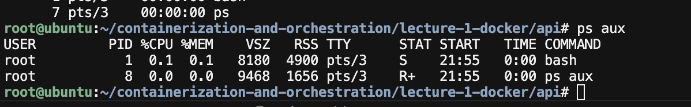
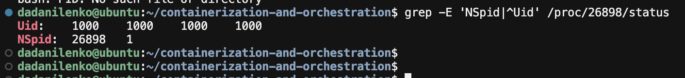
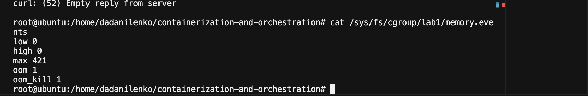
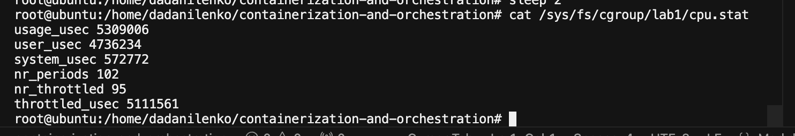
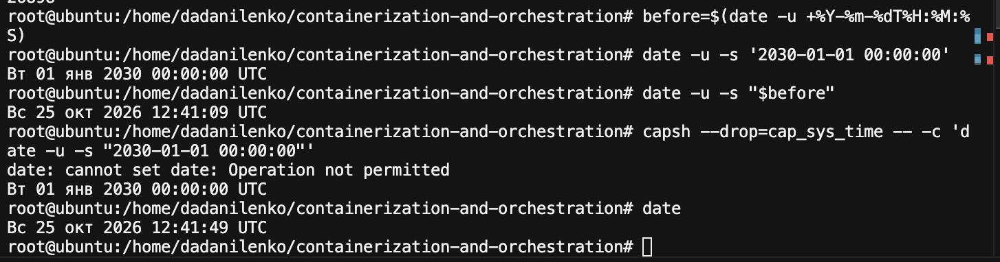
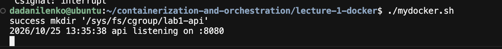
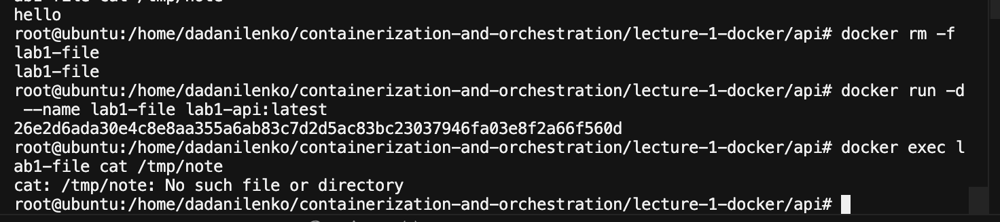
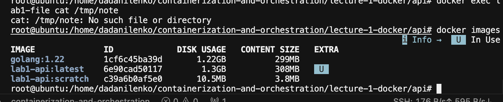
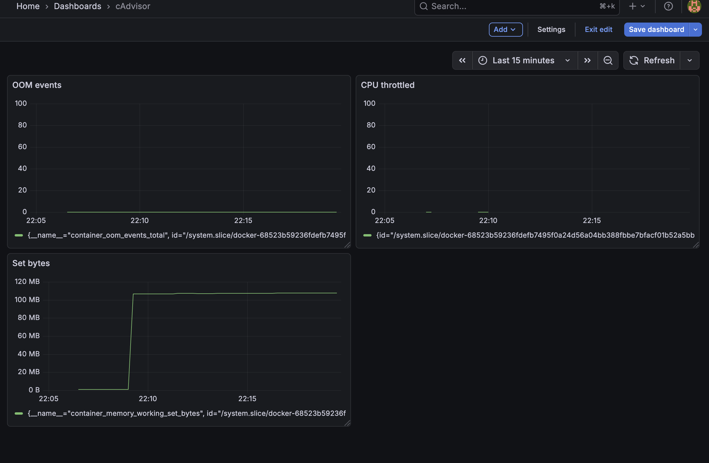

# Лабораторная 1 - свой docker

## Введение
Лаба оказалась для нас непростой, много вещей пришлось гуглить и заново перечитывать весьма интересные факты про Linux. Заранее извиняемся, если какие-то вещи, описываемые в отчете, будут описаны неточно. Мы старались

## Часть 0 - свой сервис
Сгенерировали сервис, написанный на Go. Запустили командой
```
go run .
```

## Часть 1 - запуск без изоляции
Запустили на хосте без изоляции, убедились что pid большой и очень далек от единицы. Понимаем, что в данный момент процесс не имеет ограничений по ресурсам и может съесть все ресурсы в нашем случае виртуальной машины.

## Часть 2 - namespaces
Запускаем bash внутри namespaces
```
unshare --user --map-root-user --pid --fork --mount --mount-proc --net --uts --ipc bash
```
Перечислим, что изолирует каждый неймспейс:
1. user, map-root-user - изолирует мапу uid/gid, root внутри, но снаружи непривелегированный
2. pid - своя таблица PID, внутри видим что наш процесс отображается как PID 1
3. mount - свое дерево примонтированных файловых систем, в т. ч. /proc
4. net - изолирует сеть
5. uts - свой хостнейм

Внутри процесс отображается с PID 1


Снаружи PID 26898


## Часть 3 - cgroups

cgroups отвечают за ограничение ресурсов процессу, глобально у нас три основных метрики, которые мы можем ограничить:
- cpu
- ram
- количество процессов

Сделали cgroup и вписали туда PID папа-процесса (bash из хостовой таблицы PID). 

Задали ограничения по RAM и CPU, спровоцировали OOM


далее обратились на ручку `/burn` и наблюдали тротлинг процесса


Задали ограничение по форк-процессам (max 20) и запустили форк-бомбу, наблюдали что текущее значение никогда не превышает 20 запущенных процессов.

## Часть 4 - права

В этой части сбросили лишний бит процессу и наблюдали, как выглядит ошибка при таком ограничении.


Также написали seccomp.json и наблюдали работу BPF-фильтра в ядре.

Если вкратце, то capabilities отвечает за привилегии процесса, а seccomp - какие системные вызовы процесс может вызывать.

## Часть 5 - свой docker

Написали файл mydocker.sh, который по сути объединяет в себе все выполненные ранее команды, однако несколько дополнен, чтобы обладать свойством идемпотентности.



Тот же сервис подняли с помощью docker run. Docker оказался жестче по правам (capabilities & seccomp) и чуть удобнее по сети, в том плане что в mydocker.sh мы собирали сети сами, а во втором варианте это делает докер демон. Помимо всего прочего, готовый образ подразумевает готовую файловую систему.

## Часть 6 - образы

Тут мы уже собрали образ с помощью Dockerfile и проверили, что файл положенный в контейнер, действительно исчезает после пересоздания контейнера в случае отсутствия нужного вольюма.



Собрали толстый образ, а потом сделал multi-stage сборку. Получили следующие результаты:


Потом создали том и подняли контейнер с подключенным вольюмом, убедились, что файл не удаляется после пересоздания.

## Часть 7 - gVisor
Так, в классическом случае процесс обслуживается ядром, то есть именно ядро обслуживает посылаемые процессом системные вызовы. В случае с gVisor у нас появляется прослойка в виде Sentry, которая в свою очередь обслуживает посылаемые процессом системные вызовы. За счет этой прослойки обеспечивается более сильная изоляция.

В обоих случаях одинаков код ядра, то есть если в коде ядра есть уязвимости то их можно эксплуатировать во всех вариантах контейнеризации. Всегда хост остается один.

## Часть 8 - мониторинг
Установили сразу cAdvisor, убедились в наличии метрик на ВМ. Прокинули туннель с linux-вм на операционную систему автора (macos), далее в чарте прометеуса добавили новый таргет и собрали следующий борд в графане:



Из алертов, я бы взял следующие три метрики:
1. Приближение к пределу RAM (например при 90% от доступного, я бы триггерил алерт)
2. Приближение к пределу CPU (то же самое, что и с RAM)
3. Количество сработавших OOM/Ненулевой тротлинг