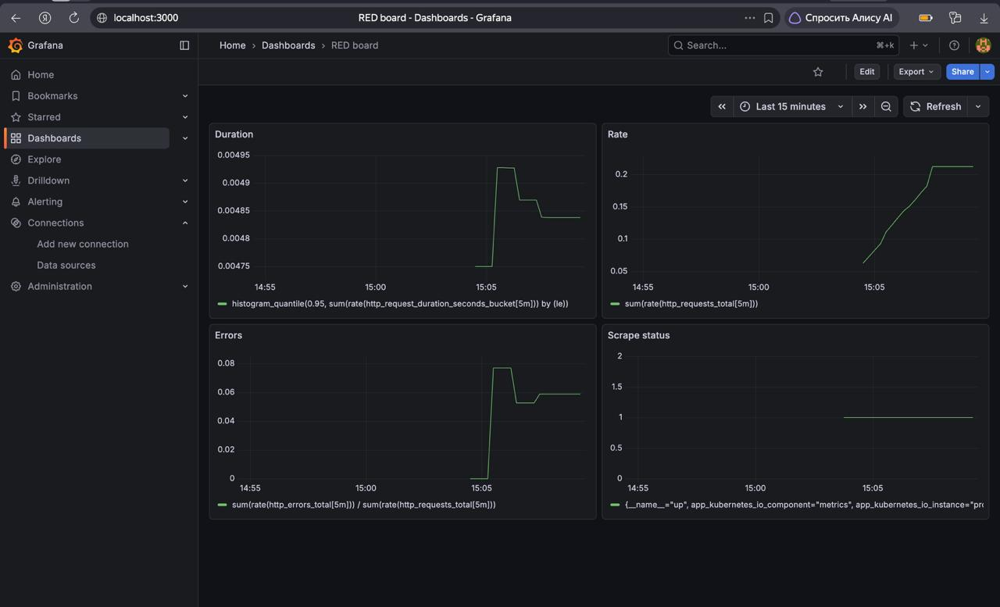
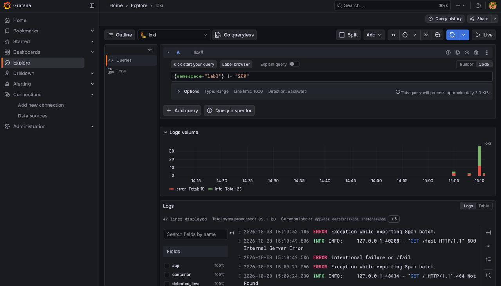
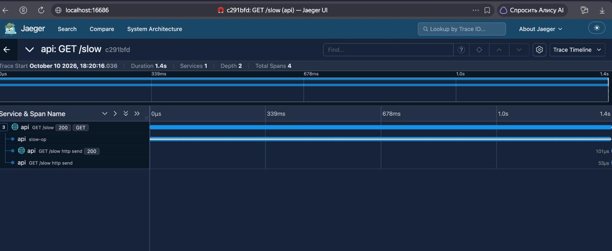
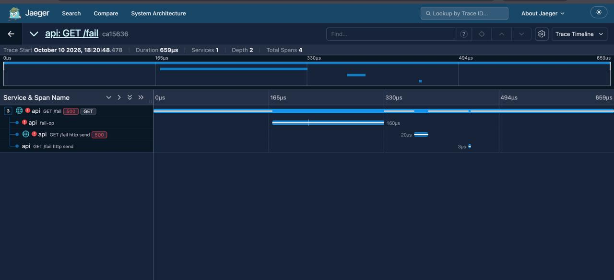
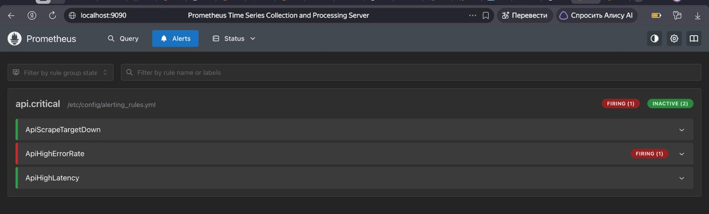
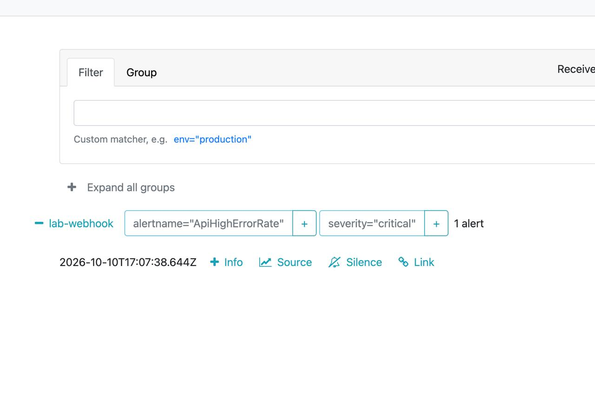
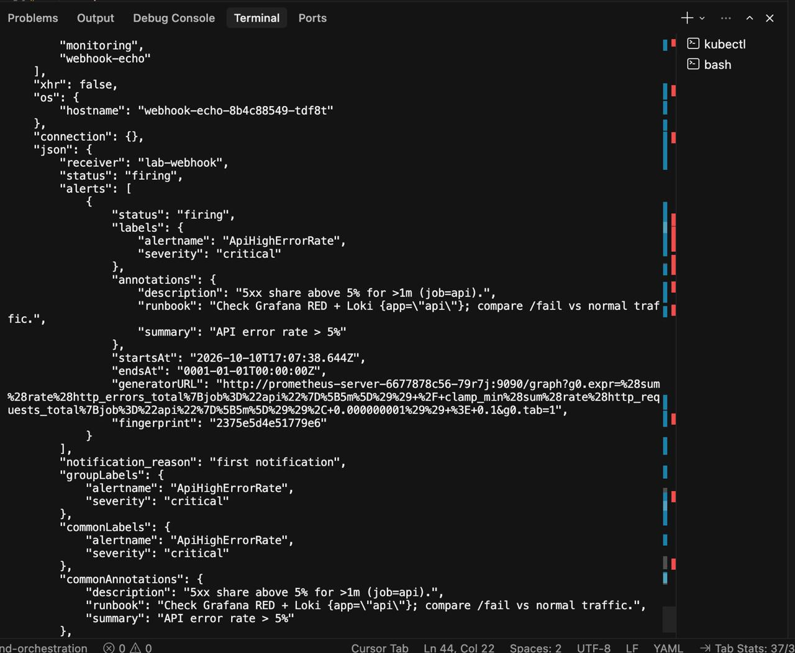
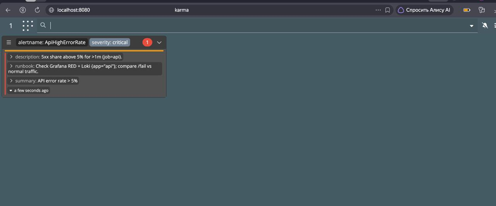

# Отчет по lab2

## Введение
Решили начать именно с этой лабораторной, тк ее можно будет переиспользовать в других лабах с целью замониторить написанные сервисы. Все сервисы мониторинга решили поднимать в отдельном namespac`е и не привязывать его жестко ко второй лабе.

Код сервиса - [тут](./api/)

Чарты сервисов мониторинга - [тут](../monitoring/)

## Часть 0 - сервис
В части 0 мы сгенерировали сервис, ничего нового - просто по ТЗ, завелось с первого раза.

## Часть 1 - Prometheus
Подняли prometheus с помощью публичного helm-чарта, прокинули порт с помощью `port-forward`, настроили скрейпинг метрик с приложения, указав в helm-чарте значения:
```
- job_name: api
  metrics_path: /metrics
  static_configs:
    - targets:
        - api.lab2.svc.cluster.local:8000
```

Подняли Grafana, креды передали с помощью переменных окружения и k8s secret. Подключили Prometheus как источник. 

Собрали маленький RED-дашборд:


## Часть 2 - Сбор логов
Подняли Loki с помощью публичного хелм-чарта, записали себе, что Loki это именно хранилище логов, само оно ничего не собирает. А в качестве агента-сборщика логов использовали Promtail. Агент запускаем в абстракции DaemonSet, тк нам нужен агент на каждой ноде, DaemonSet как раз гарантирует один экземпляр на ноду.

Подключили Loki в ту же Grafana, убедились что логи видно в графане:



## Часть 3 - Трейсы

Подняли Jaeger all-in-one, с помощью переменной окружения задали `OTEL_EXPORTER_OTLP_ENDPOINT`, нашли запрос `/slow` и `/fail` в Jaeger UI, также взяли запрос из логов и нашли его трейс по `trace_id`.





## Часть 4 - Алерты

Подняли Alertmanager и Karma, описали 3 критичных алерта в Prometheus с помощью языка запросов - PromQL.
Мы выбрали три алерта со следующим смыслом: 

1 - алерт на `up == 0`: сервис пропал с мониторинга.
2 - алерт на процент ошибок
3 - алерт на повышенный latency (берем 95 перцентиль)

В качестве получателя алерта настроили вебхук

Срабатывание правила в прометеусе:


Появление алерта в Alertmanager:


Срабатывание вебхука:


Алерт в Karma:


## Вывод
Лабораторная понравилась, в работе мы не работали именно с развертыванием Grafana, Prometheus и других сервисов, а тут получилось потрогать это на практике.